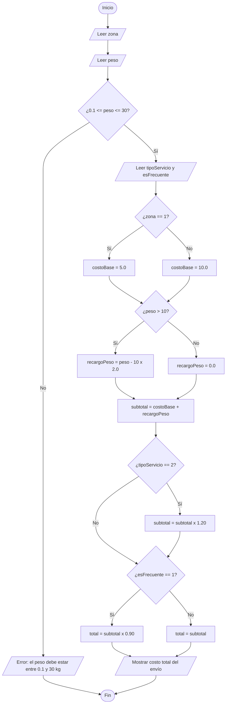

<a name="inicio"></a>

<div align="center">


# ⭐ TAREA-PROGRAMACION ⭐

### 🏆 Ejercicio Paquetes · Sistema de envío de paquetes

*Códigos de programación en Java y C++*


</div>

<p align="center">
  <strong>🏟️ EL ESTADIO DEL CÓDIGO · FACULTAD DE INGENIERÍA EN SISTEMAS, ELECTRÓNICA E INDUSTRIAL</strong><br>
  <em>«Las grandes noches europeas no se ganan con suerte: se ganan validando cada dato antes del pitido inicial.»</em>
</p>

<div align="center">


<br>


<br><br>

**Bienvenido a la noche de Champions, capitán.**<br>
Este repositorio contiene la solución del **Ejercicio Paquetes**: un sistema de envío de paquetes que considera la **zona** (local o nacional), el **peso** entre 0.1 y 30 kg, el **tipo de servicio** (normal o exprés), si el cliente es **frecuente** y un **recargo** por exceso de 10 kg.<br>
El ejercicio incluye análisis, algoritmo, pseudocódigo, diagrama de flujo, **10 pruebas de escritorio** y codificación en **Java** y **C++**.

**Un capitán. Dos finalistas. Diez partidos. Cero errores de compilación.**

[🏟️ Expediente](#expediente) ·
[⭐ Capitán](#capitan) ·
[📋 Fase de grupos](#fase-de-grupos) ·
[🧠 Táctica](#tactica) ·
[⚽ Partidos](#partidos) ·
[▶️ Cómo jugar](#como-jugar) ·
[🏆 Trofeo](#trofeo)

</div>

---

<a name="expediente"></a>

## 🏟️ El expediente · ¿De qué trata este repositorio?

Como en el torneo más grande de Europa, aquí nadie entra a la cancha sin pasar el control: el programa **valida** cada dato antes de usarlo, calcula la tarifa base según la zona, suma el recargo por peso, aplica el recargo exprés y, al final, premia al cliente frecuente con un descuento.

<div align="center">

</div>

### 🎯 Objetivos del torneo

- **Validar los límites**: aceptar solo zonas 1 o 2, servicios 1 o 2, respuestas 1 o 2 y pesos entre 0.1 y 30 kg.
- **Definir prioridades**: aplicar los cálculos en orden: tarifa base → recargo por peso → recargo exprés → descuento por cliente frecuente.
- **Probar antes de programar**: diseñar 10 pruebas de escritorio antes de escribir el código.
- **Jugar en dos estadios**: obtener los mismos resultados en **Java** y en **C++**.

> [!TIP]
> **Lema del vestuario:** «El orden de las operaciones es como el orden de los penales: si lo cambias, cambia el resultado».

---

<a name="capitan"></a>

## ⭐ El capitán · Integrante y rol

Esta final se juega con un solo capitán en la cancha:

<div align="center">

</div>

| N.º | Integrante | Rol en la final | Componentes |
| :---: | :--- | :--- | :--- |
| **1** | **PAREDES ACOSTA DERECK SHAIR** | **Capitán del Código · Analizar, diseñar, probar y programar** | Análisis, algoritmo, pseudocódigo, diagrama de flujo, 10 pruebas de escritorio y código en **Java** y **C++**. |

| Dato | Detalle |
| :--- | :--- |
| **Asignatura** | Algoritmos y Lógica de Programación |
| **Nivel y paralelo** | Primero - B |
| **Docente** | Ing. José Ruben Caizabuano, M.Sc. |
| **Universidad** | Universidad Técnica de Ambato |

---

<a name="fase-de-grupos"></a>

## 📋 Fase de grupos · Análisis de datos

### ⚽ Las reglas del torneo

| Regla | Condición | Efecto |
| :--- | :--- | :--- |
| 🏠 **Tarifa local** | `zona == 1` | Costo base de **$5.00** |
| ✈️ **Tarifa nacional** | `zona == 2` | Costo base de **$10.00** |
| ⚖️ **Exceso de peso** | `peso > 10` | Recargo de **$2.00** por cada kg extra: `(peso - 10) * 2` |
| ⚡ **Servicio exprés** | `tipoServicio == 2` | Recargo del **20%**: `subtotal * 1.20` |
| ⭐ **Cliente frecuente** | `esFrecuente == 1` | Descuento del **10%**: `total * 0.90` |
| 🟥 **Peso inválido** | `peso < 0.1` o `peso > 30` | Mensaje de error |

### 🔵 Entrada · Proceso · Salida

| Fase | Datos |
| :--- | :--- |
| **🔵 Entrada** | `zona` (1: Local, 2: Nacional), `peso` en kg, `tipoServicio` (1: Normal, 2: Exprés) y `esFrecuente` (1: Sí, 2: No). |
| **⚪ Proceso** | Validar el peso, asignar la tarifa base, calcular el recargo por peso, aplicar el recargo exprés y el descuento por cliente frecuente. |
| **🌟 Salida** | Costo total del envío, o un mensaje de error si los datos son inválidos. |

### 🧬 Variables del programa

| Variable | Tipo | ¿Para qué sirve? |
| :--- | :---: | :--- |
| `zona` | `int` | 1 = Local, 2 = Nacional |
| `peso` | `double` | Peso del paquete en kg |
| `tipoServicio` | `int` | 1 = Normal, 2 = Exprés |
| `esFrecuente` | `int` | 1 = Sí, 2 = No |
| `costoBase` | `double` | Tarifa según la zona |
| `recargoPeso` | `double` | Recargo por los kg sobre 10 |
| `subtotal` | `double` | `costoBase + recargoPeso`, con el 20% si es exprés |
| `total` | `double` | Costo final, con el 10% de descuento si es frecuente |

---

<a name="tactica"></a>

## 🧠 La táctica · Algoritmo, pseudocódigo y flujo

### 📝 Algoritmo

1. Inicio.
2. Leer la zona del envío (1 para local, 2 para nacional).
3. Leer el peso del paquete en kg.
4. Si el peso es menor a 0.1 o mayor a 30, mostrar «Peso inválido» y terminar.
5. Leer el tipo de servicio (1 para normal, 2 para exprés).
6. Leer si el cliente es frecuente (1 para sí, 2 para no).
7. Asignar el costo base según la zona (5.0 para local, 10.0 para nacional).
8. Si el peso es mayor a 10 kg, calcular `recargo = (peso - 10) * 2.0`.
9. Sumar el costo base y el recargo por peso en un subtotal.
10. Si el servicio es exprés, multiplicar el subtotal por 1.20.
11. Si el cliente es frecuente, multiplicar el monto por 0.90.
12. Imprimir el costo total del envío.
13. Fin.

### 📖 Pseudocódigo (núcleo del proceso)

```text
SI zona == 1 ENTONCES
    costoBase <- 5.0
SINO
    costoBase <- 10.0
FIN SI

SI peso > 10 ENTONCES
    recargoPeso <- (peso - 10) * 2.0
SINO
    recargoPeso <- 0.0
FIN SI

subtotal <- costoBase + recargoPeso

SI tipoServicio == 2 ENTONCES
    subtotal <- subtotal * 1.20
FIN SI

SI esFrecuente == 1 ENTONCES
    total <- subtotal * 0.90
SINO
    total <- subtotal
FIN SI
```

### 🔁 Diagrama de flujo



### ⚔️ Java vs C++ · Dos finalistas, una misma táctica

| Jugada | ☕ Java | ⚙️ C++ |
| :--- | :--- | :--- |
| Comprobar que el dato es número | `sc.hasNextInt()` / `sc.hasNextDouble()` | `if (cin >> variable)` |
| Limpiar una entrada inválida | — | `cin.clear()` + `cin.ignore(...)` |
| Repetir hasta que el dato sea válido | `while (!valido)` | `while (!valido)` |
| Tarifa base | `(zona == 1) ? 5.0 : 10.0` | `(zona == 1) ? 5.0 : 10.0` |
| Formato de 2 decimales | `printf("%.2f")` | `cout.setf(ios::fixed)` + `cout.precision(2)` |

---

<a name="partidos"></a>

## ⚽ Los 10 partidos · Prueba de escritorio

| Partido | Zona | Peso | ¿Peso inválido? | Servicio | Frecuente | Costo base | Recargo peso | Subtotal | Total | Resultado |
| :---: | :--- | :---: | :---: | :--- | :---: | :---: | :---: | :---: | :---: | :--- |
| **1** | Local | 5.0 | Falso | Normal | No | $5.00 | $0.00 | $5.00 | **$5.00** | ✅ Costo total: $5.00 |
| **2** | Local | 5.0 | Falso | Normal | Sí | $5.00 | $0.00 | $5.00 | **$4.50** | ✅ Costo total: $4.50 |
| **3** | Nacional | 8.0 | Falso | Normal | No | $10.00 | $0.00 | $10.00 | **$10.00** | ✅ Costo total: $10.00 |
| **4** | Local | 12.0 | Falso | Normal | No | $5.00 | $4.00 | $9.00 | **$9.00** | ✅ Costo total: $9.00 |
| **5** | Nacional | 15.0 | Falso | Exprés | No | $10.00 | $10.00 | $24.00 | **$24.00** | ✅ Costo total: $24.00 |
| **6** | Local | 20.0 | Falso | Exprés | Sí | $5.00 | $20.00 | $30.00 | **$27.00** | ✅ Costo total: $27.00 |
| **7** | Nacional | 30.0 | Falso | Normal | Sí | $10.00 | $40.00 | $50.00 | **$45.00** | ✅ Costo total: $45.00 |
| **8** | Nacional | 30.0 | Falso | Exprés | Sí | $10.00 | $40.00 | $60.00 | **$54.00** | ✅ Costo total: $54.00 |
| **9** | Local | 0.05 | Verdadero | — | — | — | — | — | — | 🟥 Error: peso entre 0.1 y 30 kg |
| **10** | Nacional | 35.0 | Verdadero | — | — | — | — | — | — | 🟥 Error: peso entre 0.1 y 30 kg |

> [!NOTE]
> El **subtotal** de la tabla ya incluye el 20% del servicio exprés, y el **total** ya incluye el 10% de descuento por cliente frecuente.

**Ejemplo de ejecución (partido 8 · la gran final)**

```text
Ingrese zona (1: Local, 2: Nacional): 2
Ingrese peso en kg (0.1 a 30): 30
Ingrese tipo de servicio (1: Normal, 2: Exprés): 2
¿Es cliente frecuente? (1: Sí, 2: No): 1
Costo total del envío: $54.00
```

**Peso fuera de rango**

```text
Ingrese peso en kg (0.1 a 30): 35
Error: el peso debe estar entre 0.1 y 30 kg.
Ingrese peso en kg (0.1 a 30):
```

---

## 🗂️ El vestuario · Estructura del repositorio

```text
tarea-programacion/
┣ 📂 Ejercicio Paquetes/
┃ ┣ 📜 EjercicioPaquetes.java
┃ ┣ 📜 EjercicioPaquetes.cpp
┃ ┗ 📜 Ejercicio Paquetes.pdf
┗ 📜 README.md
```

---

<a name="como-jugar"></a>

## ▶️ Cómo jugar · Que ruede el balón

**☕ Finalista 1 · Java**

```bash
javac EjercicioPaquetes.java
java EjercicioPaquetes
```

**⚙️ Finalista 2 · C++**

```bash
g++ EjercicioPaquetes.cpp -o EjercicioPaquetes
./EjercicioPaquetes
```

> [!IMPORTANT]
> - El archivo de Java debe llamarse igual que la clase: **`EjercicioPaquetes.java`**.
> - Escribe los decimales con **punto** (`12.5`), como indica el propio programa.
> - En Windows, ejecuta el programa de C++ con `EjercicioPaquetes.exe`.

---

<a name="trofeo"></a>

## 🏆 El trofeo · Fin de la final

<div align="center">


*«Sonó el pitido final, capitán. Las cuentas cuadraron en los 10 partidos y la orejona ya está en la vitrina.»*

Si llegaste hasta aquí, el estadio entero te aplaude. ⭐🏆⚽🏟️

[⬆️ Volver al inicio](#inicio)


</div>
